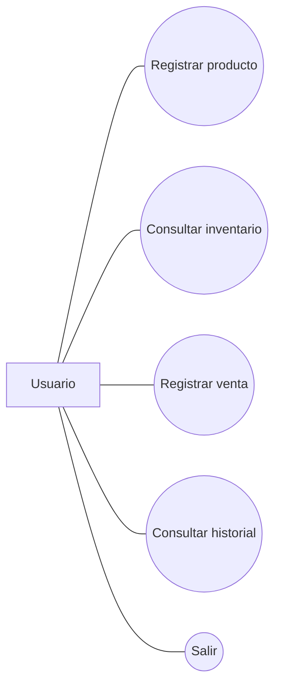

# Diagrama de casos de uso

El actor representa al usuario que opera la aplicación de consola. Los casos de uso corresponden a las funciones disponibles en la versión inicial.

## Descripción
- Registrar producto: ingresar nombre, precio y stock inicial.
- Consultar inventario: revisar productos y existencias.
- Registrar venta: seleccionar un producto y una cantidad disponible.
- Consultar historial: revisar las ventas registradas y el total acumulado.
- Salir: cerrar la aplicación.
