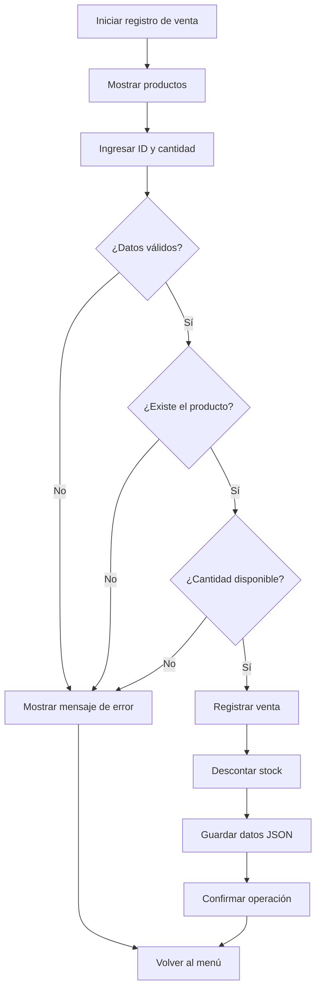

# Flujo de registro de venta

El flujo muestra las validaciones que realiza el sistema antes de confirmar una venta.

## Reglas principales
1. El producto debe existir.
2. La cantidad debe ser mayor que cero.
3. El stock debe ser suficiente.
4. La venta se registra y el inventario se actualiza cuando todas las validaciones son correctas.
